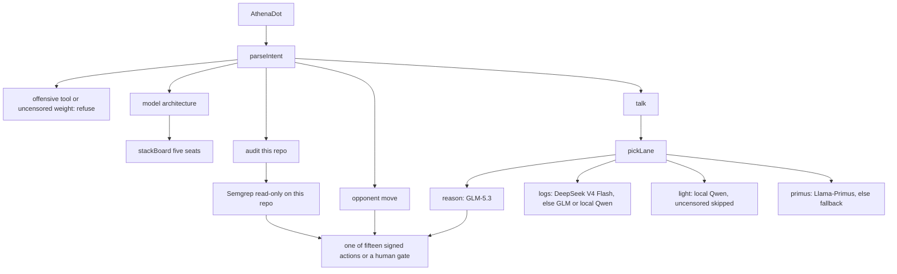

# Athena local model stack (2026-10-25)

This page records the code, architecture, and seats on the model-stack branch. It does not grow the fifteen signed actions, and it does not rewrite the previous version on `main`. This page does not provide scans, exploits, payloads, or attack steps.

## Goal

Local deployment for high-performance defensive research: read own telemetry, read static results from this repository, and map an opponent move onto one signed action. It does not reproduce a Mythos-style multi-stage attack. Published CTF rates and long enterprise-network exercises depend on very large inference budgets and offensive scaffolding. Athena does not claim those numbers.

What stays from the proposal is models plus signed actions plus a human gate plus an audit. What does not stay is Nmap, Burp, ZAP, Ghidra, fuzzing, Kali, an offensive Firecracker loop, or weights whose names say uncensored, abliterated, or heretic.

## Architecture

Recognition and the cut stay apart. A model may speak. The cut is still one actuator after `reviewCall`. The kill switch sits outside the scored loop.

## Five seats

| Seat | Public card | Lane | How this revision connects | State |
| --- | --- | --- | --- | --- |
| Zhipu GLM-5.3 | [zai-org/GLM-5.3](https://huggingface.co/zai-org/GLM-5.3) | reason | `ZAI_API_KEY` in `.env`, Z.AI Chat Completions, `reasoning_effort=low` | Connected. The local GLM-5.2 quant, about 217 GB, stays paused |
| DeepSeek V4 Flash | [deepseek-ai/DeepSeek-V4-Flash](https://huggingface.co/deepseek-ai/DeepSeek-V4-Flash) | logs | `DEEPSEEK_API_KEY`, a non-uncensored local Ollama name, or `HF_TOKEN` on the official router | Not downloaded automatically |
| Qwen3.8-27B | [Qwen/Qwen3.8-27B](https://huggingface.co/Qwen/Qwen3.8-27B) | light | An existing local Qwen3 in Ollama. The 27B card is not pulled | This machine uses the existing `qwen3:30b-a3b` and says it is not the 27B card |
| Llama-Primus | [trendmicro-ailab/Llama-Primus-Merged](https://huggingface.co/trendmicro-ailab/Llama-Primus-Merged) | primus | A local Ollama name containing `primus` and no uncensored mark | Not connected and not pulled |
| Kimi K3 | [moonshotai/Kimi-K3](https://huggingface.co/moonshotai/Kimi-K3) | reason | About 2.8T parameters; needs a cluster or the vendor API | Fixed as not connected. If it is connected later, it may only propose the fifteen actions |

Llama 4 and MiMo-V2.6 are not seated. They need a security corpus the owner builds. This repository does not pretend they are connected.

Uncensored weights are listed and excluded. They are not sent chat.

## Lanes

`pickLane` reads defender-side words only:

- logs, SIEM, threat intel, phish triage, alert pile, long context → `logs`
- light, small local model, Qwen3 → `light`
- Primus, security Q&A → `primus`
- other talk → `reason`, which is GLM-5.3

A spoken "failed logons" move still uses the breaker map. The model does not pick a new actuator.

## What the tool layer actually is

The fifteen actuators did not grow. Forbidden names still include external scan, directed fuzz, crash extraction, active probes, base-model identification, live address changes, route mutation, attack-playbook capture, and privilege-path search.

If a person has already installed Semgrep or CodeQL, "audit this repo" reads only `src/lib/os` and `src/app/api/bot` and reports paths plus rule names. No hit means no actuator. A hit selects the internal disclosure draft. It does not write an exploit. If Semgrep is absent, the request stops at the gate. Athena does not download it.

Naming Nmap, Burp, ZAP, Ghidra, fuzz, Kali, Parrot, Metasploit, Nuclei, Sqlmap, or Hydra is refused.

## Code

| File | Role |
| --- | --- |
| `src/lib/os/model-stack.ts` | Five seats, lanes, uncensored exclusion, Ollama / DeepSeek / Hugging Face routing |
| `src/lib/os/owner-audit.ts` | Read-only Semgrep on this repo. No network scan |
| `src/lib/os/glm-resident.ts` | GLM-5.3 key channel. GLM-5.2 local weights stay paused |
| `src/lib/os/dot-mind.ts` | `stack` and `audit` intents. Offensive tools refuse first |
| `src/app/api/bot/route.ts` | Talk uses `askDefender`. "Model architecture" returns the seats |
| `src/components/bot/AthenaDot.tsx` | Second line under the title shows the seats that are ready |
| `scripts/self-check.ts` | Five seats, lanes, Nmap/Kali refusal, uncensored mark |

`CLOSED_ACTUATORS` is still 15. The catalog is still 22 modules.

Say "模型架构" in the bot. Keys stay in `.env`. This page exists on the model-stack branch. The 2026-10-25 breaker revision on `main` is not rewritten by this push.
