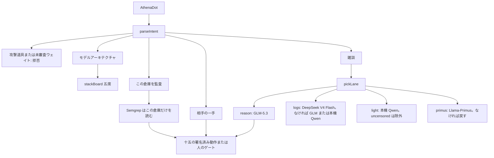

# Athena ローカルモデル栈（2026-10-25）

この頁は、モデル栈ブランチのコード、アーキテクチャ、座席を記録します。署名済み十五動作は増えません。`main` の旧版も書き換えません。走査、悪用、ペイロード、攻撃手順は書きません。

## 目標

ローカル配備で、防御側の高性能な調査をすることです。自陣の計測を見て、このリポジトリの静的結果を読み、相手の一手を署名済み動作一つへ写します。Mythos 型の多段階攻撃は再現しません。公開された CTF 成功率や長い企業網演習は、大きな推論予算と攻撃足場に依存します。Athena はその数字を主張しません。

残すのは「モデル + 署名済み動作 + 人のゲート + 監査」です。残さないのは Nmap、Burp、ZAP、Ghidra、Fuzzing、Kali、攻撃用 Firecracker、名前に uncensored / abliterated / heretic を含むウェイトです。

## アーキテクチャ

認識と切断は分かれます。モデルは話します。切断は `reviewCall` のあとの一つの実行器です。キルスイッチは採点される循環の外です。

## 五席

| 席 | 公開カード | 車線 | この版の接続 | 状態 |
| --- | --- | --- | --- | --- |
| 智譜 GLM-5.3 | [zai-org/GLM-5.3](https://huggingface.co/zai-org/GLM-5.3) | reason | `.env` の `ZAI_API_KEY`。Z.AI Chat Completions。`reasoning_effort=low` | 接続済み。本機 GLM-5.2 約 217 GB は停止のまま |
| DeepSeek V4 Flash | [deepseek-ai/DeepSeek-V4-Flash](https://huggingface.co/deepseek-ai/DeepSeek-V4-Flash) | logs | `DEEPSEEK_API_KEY`、未審査でない本機 Ollama、または `HF_TOKEN` | 自動では落とさない |
| Qwen3.8-27B | [Qwen/Qwen3.8-27B](https://huggingface.co/Qwen/Qwen3.8-27B) | light | 既にある本機 Qwen3。27B カードは落とさない | この機械は既存の `qwen3:30b-a3b` を使い、27B ではないと書く |
| Llama-Primus | [trendmicro-ailab/Llama-Primus-Merged](https://huggingface.co/trendmicro-ailab/Llama-Primus-Merged) | primus | 名前に `primus` があり未審査でない Ollama | 未接続。自動では落とさない |
| Kimi K3 | [moonshotai/Kimi-K3](https://huggingface.co/moonshotai/Kimi-K3) | reason | 約 2.8T。クラスタまたは公式 API | 未接続で固定。後でつながっても十五動作しか提案できない |

Llama 4 と MiMo-V2.6 は席にありません。所有者が安全データを作る必要があります。この倉庫は接続済みとは書きません。

未審査ウェイトは一覧に出し、会話へは送りません。

## 車線

`pickLane` は防御側の語だけを見ます。

- ログ、SIEM、脅威情報、フィッシング仕分け、警報の山、長い文脈 → `logs`
- 軽量、本機の小さいモデル、Qwen3 → `light`
- Primus、安全の問答 → `primus`
- その他の雑談 → `reason`、つまり GLM-5.3

「ログイン失敗」という一手は、これまでどおりブレーカの対応です。モデルは動作を選び直しません。

## 道具層の実体

十五の実行器は増えていません。禁止には、外向き走査、指向ファズ、クラッシュ抽出、能動探査、基盤モデル識別、実アドレス変更、経路変異、攻撃手順の保存、権限経路の検索が残ります。

人が Semgrep または CodeQL を既に入れているとき、「この倉庫を監査」は `src/lib/os` と `src/app/api/bot` だけを読み、パスと規則名を返します。命中がなければ動作しません。命中があれば内部告知の下書きを選びます。悪用は書きません。Semgrep がなければゲートで止まり、Athena は自分では落としません。

Nmap、Burp、ZAP、Ghidra、Fuzz、Kali、Parrot、Metasploit、Nuclei、Sqlmap、Hydra と言うと拒否します。

## コード

| ファイル | 役割 |
| --- | --- |
| `src/lib/os/model-stack.ts` | 五席、車線、未審査除外、Ollama / DeepSeek / Hugging Face の経路 |
| `src/lib/os/owner-audit.ts` | この倉庫の Semgrep 読み取り。網は走査しない |
| `src/lib/os/glm-resident.ts` | GLM-5.3 の鍵経路。GLM-5.2 本機ウェイトは停止のまま |
| `src/lib/os/dot-mind.ts` | `stack` と `audit`。攻撃道具は先に拒否 |
| `src/app/api/bot/route.ts` | 雑談は `askDefender`。「モデルアーキテクチャ」は席の説明 |
| `src/components/bot/AthenaDot.tsx` | 題名の下の二行目に在席を出す |
| `scripts/self-check.ts` | 五席、車線、Nmap/Kali 拒否、未審査印 |

`CLOSED_ACTUATORS` は 15 のままです。モジュールは 22 のままです。

ボットで「模型架构」と言うと席が見えます。鍵は `.env` だけです。この頁はモデル栈ブランチにあります。`main` の 2026-10-25 ブレーカ版は、この push では書き換わりません。
