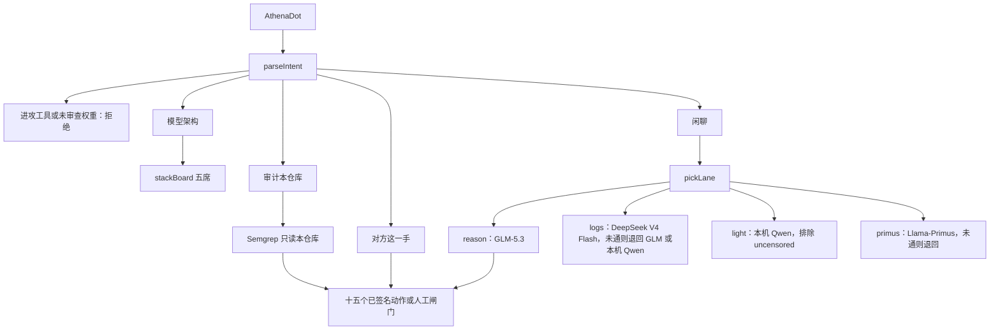

# Athena 本地模型栈（2026-10-25）

这一页记录模型栈分支上的代码、架构和座位。它不改变十五个已签名动作，也不把 `main` 上的旧版本改掉。本文不提供扫描、利用、载荷或攻击步骤。

## 目标

本地部署，做高性能的防守研究：看己方遥测、读本仓库的静态结果、把对方这一手映射到一个已签名动作。不是复现 Mythos 式的多阶段进攻。公开评测里的 CTF 成功率和 32 步企业网演练，依赖超大推理预算和进攻脚手架。Athena 不声称达到那些数字。

方案里能留下的是「模型 + 已签名动作 + 人工闸门 + 审计」。方案里不能留下的是 Nmap、Burp、ZAP、Ghidra、Fuzzing、Kali、Firecracker 进攻沙箱，以及名称里带 uncensored / abliterated / heretic 的权重。

## 架构

识别和落刀分开。模型只说话。落刀仍是 `reviewCall` 之后的一个执行器。杀开关在被评分的循环外面。

## 五个座位

| 座位 | 公开卡 | 车道 | 这一版的接通方式 | 状态 |
| --- | --- | --- | --- | --- |
| 智谱 GLM-5.3 | [zai-org/GLM-5.3](https://huggingface.co/zai-org/GLM-5.3) | reason | `.env` 的 `ZAI_API_KEY`，Z.AI Chat Completions，`reasoning_effort=low` | 已接通。本机 GLM-5.2 约 217 GB 量化仍暂停 |
| DeepSeek V4 Flash | [deepseek-ai/DeepSeek-V4-Flash](https://huggingface.co/deepseek-ai/DeepSeek-V4-Flash) | logs | `DEEPSEEK_API_KEY`，或本机 Ollama 里名称匹配且不含未审查标记的卡，或 `HF_TOKEN` 走官方路由 | 未自动下载。没有密钥或本机卡时显示未接通 |
| Qwen3.8-27B | [Qwen/Qwen3.8-27B](https://huggingface.co/Qwen/Qwen3.8-27B) | light | 本机 Ollama 里已有的 Qwen3。不会把 27B 卡自动拉下来 | 这台机器上用已有的 `qwen3:30b-a3b`，并写明它不是 27B 目标卡 |
| Llama-Primus | [trendmicro-ailab/Llama-Primus-Merged](https://huggingface.co/trendmicro-ailab/Llama-Primus-Merged) | primus | 本机 Ollama 名称含 `primus` 且不含未审查标记 | 未接通，不自动拉取 |
| Kimi K3 | [moonshotai/Kimi-K3](https://huggingface.co/moonshotai/Kimi-K3) | reason | 约 2.8T，需要集群或官方 API | 固定未接通。即使以后接通，也只能提议十五个动作 |

Llama 4 和 MiMo-V2.6 不入座。它们要人自建安全数据，仓库不假装已经接上。

未审查权重会被列出并排除，不送进对话。本机若有 `uncensored` 标记的 Ollama 卡，只出现在排除名单里。

## 车道

`pickLane` 只看防守侧的词：

- 日志、SIEM、威胁情报、钓鱼分诊、告警堆积、长上下文 → `logs`
- 轻量、本机小模型、Qwen3 → `light`
- Primus、安全问答 → `primus`
- 其余闲聊 → `reason`，也就是 GLM-5.3

对方这一手里的「登录失败」仍走断路器映射，不交给模型改动作。

## 工具层实际是什么

十五个执行器没有增加。禁止项仍包括对外扫描、定向模糊测试、提取崩溃、主动探针、识别底座、真实改址、路由变异、保存攻击工具链、搜索提权路径。

人若已经把 Semgrep 或 CodeQL 装在这台机器上，`审计本仓库` 只对 `src/lib/os` 和 `src/app/api/bot` 做只读静态检查，回报路径和规则名。没有命中就不执行动作。有命中时选定「生成仅供内部的告知草稿」，不写利用。没装 Semgrep 就停在闸门，Athena 不会自己下载它。

说 Nmap、Burp、ZAP、Ghidra、Fuzz、Kali、Parrot、Metasploit、Nuclei、Sqlmap、Hydra，会被拒绝。

## 代码

| 文件 | 职责 |
| --- | --- |
| `src/lib/os/model-stack.ts` | 五席、车道、未审查排除、Ollama / DeepSeek / Hugging Face 路由、栈说明 |
| `src/lib/os/owner-audit.ts` | 本仓库 Semgrep 只读。不扫网 |
| `src/lib/os/glm-resident.ts` | GLM-5.3 密钥通道。GLM-5.2 本机权重登记保持暂停 |
| `src/lib/os/dot-mind.ts` | `stack`、`audit` 意图。进攻工具先拒绝 |
| `src/app/api/bot/route.ts` | 闲聊改走 `askDefender`。`模型架构` 返回座位说明 |
| `src/components/bot/AthenaDot.tsx` | 标题下第二行显示在岗座位 |
| `scripts/self-check.ts` | 核对五席、车道、Nmap/Kali 拒绝、未审查标记 |

`src/lib/os/constitution.ts` 的 `CLOSED_ACTUATORS` 仍是 15。`catalog.ts` 仍是 22 个模块。

## 怎么看

在 Bot 里说「模型架构」。标题下会写出在岗的座位。说「审计本仓库」只查这份代码。密钥仍只放 `.env`，不要提交。

`main` 上的 2026-10-25 断路器版本不被这次推送改写。这一页只在模型栈分支上。
