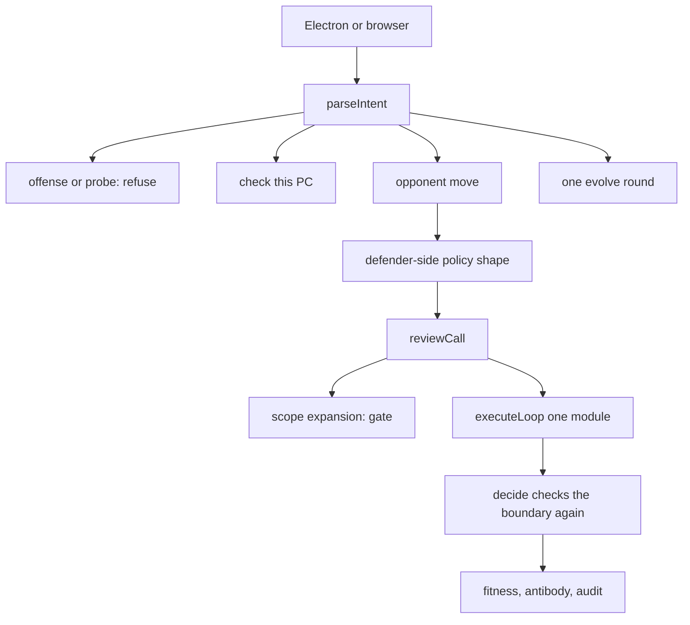
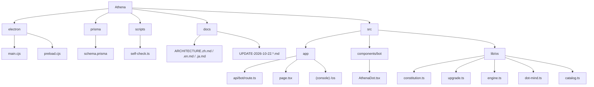
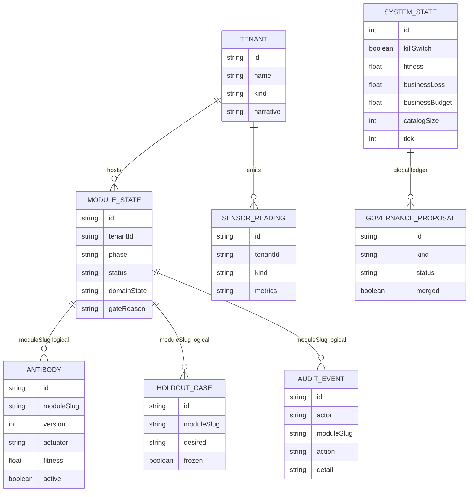

# Athena changes through 2026-10-22

This note records what is in the repository and runnable in the local chat as of 2026-10-22. Athena is still a personal defensive bot on the owner's computer. The fifteen signed actions did not grow. This note does not provide scans, exploits, payloads, or attack steps.

## Idea

Once an attacker puts a model inside a tool loop, the cheap win is to make the defender add its own privileges. Athena keeps the loop and removes "add a tool."

One round is still: observe own telemetry, infer a defender-side policy shape, propose one signed action, evaluate on a frozen holdout, promote or ask a human, roll back on failure. Fitness = attacker cost − business loss − 4 × physical risk. Alert count cannot promote. The kill switch sits outside the scored loop.

Opponent analysis reads defender-side shapes only: cadence, tool calls, scope expansion, leak-field marks, repetition, pauses, vendor health, and setpoint drift. It does not read the other party's payload, enter their network, or name their base-model vendor.

The six layers are law inside the constitution. They constrain decisions. They are not a sixteenth action.

| Layer | What the system actually does |
| --- | --- |
| Agent boundary | Every action is checked against the fifteen signed actions and the forbidden list. An out-of-bounds call is reset and not run. |
| Verifiable root | A software hash covers the action list, the forbidden list, the six layer names, and the kill switch. This machine does not claim a hardware enclave is running. |
| Repair gate | A patch stays a short proposal. A forbidden name in the text is rejected. It is not merged before the self-check, and a merge still adds no action. |
| Shape recognition | The opponent's move maps to a policy shape. No probe is sent to the other party. |
| Moving target | The shape rotates among signed actions, such as isolate or rotate a non-human identity. Real addresses, ports, and routes are not changed. |
| Synthetic self-play | Red only changes synthetic entity counts. Blue only picks from the fifteen actions. A live chat round runs the matching module. When the business budget is full, the move is recorded and fitness does not rise. |

## Change plan

1. **Root and boundary.** `decide` passes `reviewCall` again before it returns. The forbidden list now names directed fuzzing, crash-case extraction, active model probes, base-model identification, live address changes, route mutation, storing an attack toolchain, and privilege-path search.
2. **Moves in chat.** The separate upgrade button is gone. A person types the opponent's move. The system selects one signed action and tries that module's observe–evaluate–promote loop. Scope expansion stops at the gate.
3. **Desktop shell.** The window waits up to eight seconds, with retries, for the local page. It does not start a second server when one is already up. A failed probe does not block the window.

Not added: fuzzing, external probes, multi-hop privilege search, live network address changes, a hardware enclave, or unmeasured percentages.

## What you can do

At http://127.0.0.1:3030 :

- "The other side is probing" or a sudden rise in tool calls selects isolate.
- A too-regular cadence selects non-human identity rotation.
- A drop in vendor health selects the approved vendor breaker.
- Scope expansion resets at the gate and does not run.
- When business loss already equals the budget, the chosen action is stored and fitness stays put.
- PC check, screen share, camera, evolve, kill switch, and offensive refusal keep their previous bounds.

## Architecture

## Tree

## ER diagram

Solid lines are Prisma foreign keys. Dashed relations are logical links through `moduleSlug`; the database has no extra foreign key for them. `SystemState` and `GovernanceProposal` are global ledgers.

`catalogSize` stays 15. A governance proposal may sit pending. Approval still does not lengthen the list.

## Code

| File | Change |
| --- | --- |
| `src/lib/os/constitution.ts` | Six-layer law, `reviewCall`, repair gate, shape fingerprint, moving-target map, synthetic entity step, and group-relative reward. Forbidden names cover the offensive capabilities from the report. |
| `src/lib/os/upgrade.ts` | New. Software hash, synthetic self-play, and the move-to-module map. |
| `src/lib/os/engine.ts` | `decide` checks the boundary again before returning. |
| `src/lib/os/dot-mind.ts` | An opponent move is a `duel`. A bare upgrade slogan only asks for the move. |
| `src/app/api/bot/route.ts` | Runs the matching module. Scope expansion does not execute. The chat reply no longer waits on a local weight scan. |
| `src/components/bot/AthenaDot.tsx` | The upgrade button is gone. Replies are ordinary bubbles. A request ends after twenty seconds. |
| `electron/main.cjs` | The page probe waits longer and does not start a second server. |
| `scripts/self-check.ts` | Checks the six layers, the software root, the forbidden list, duel intent, and the catalog size of fifteen. |

The twenty-two modules and fifteen actions were not added to or removed. Synthetic tenants remain demo data.
