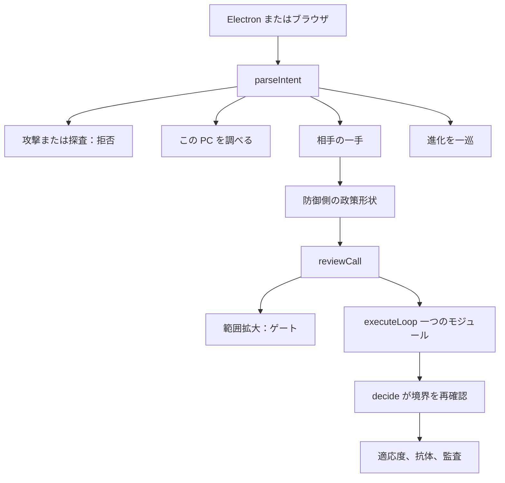
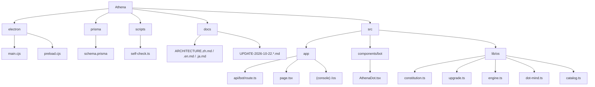
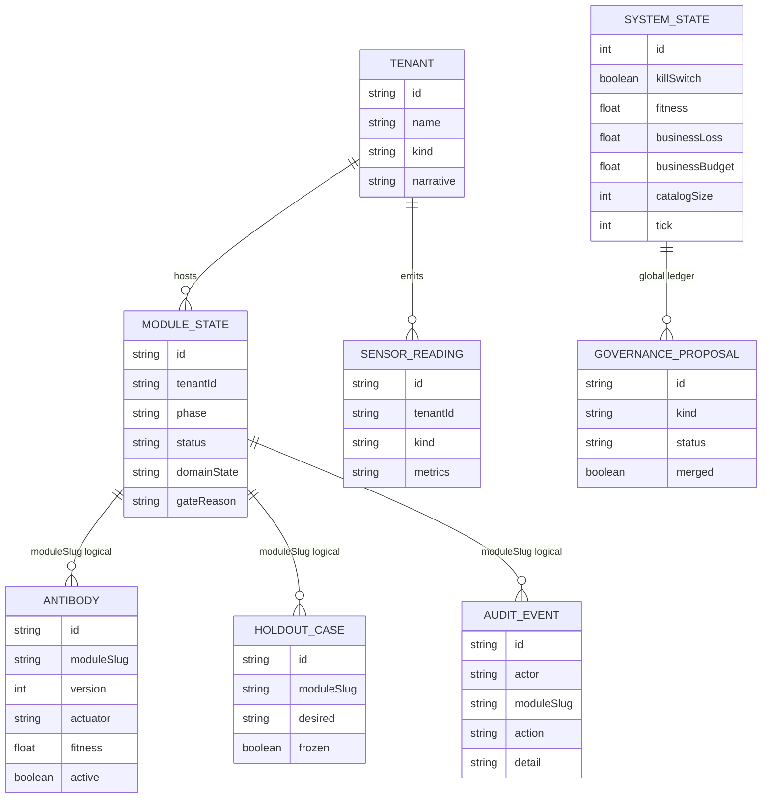

# Athena 2026-10-22 までの変更

この文書は、2026-10-22 時点でリポジトリにあり、ローカルの会話で動く変更を記録します。Athena は所有者のコンピュータに住む個人向け防御ボットのままです。署名済みの十五動作は増えていません。走査、悪用、ペイロード、攻撃手順は書きません。

## 理念

攻撃側がモデルを道具の循環に入れると、安い勝ち方は防御側に自分で権限を広げさせることです。Athena は循環を残し、「道具を足す」を外します。

一巡はこれまでどおりです。自陣の計測を見る、防御側の政策形状を推定する、署名済み動作を一つ提案する、凍結したホールドアウトで評価する、昇格するか人に尋ねる、失敗したら戻す。適応度 = 攻撃側コスト − 事業損失 − 4 × 物理リスク。警報数では昇格しません。キルスイッチは採点される循環の外にあります。

相手の分析は防御側の形状だけです。リズム、道具呼び出し、範囲拡大、漏洩フィールド印、反復、休止、委託先の健全性、設定値の漂い。相手のペイロードは読まず、相手のネットワークにも入らず、基盤モデルのベンダー名も書きません。

六層は憲法の中の法です。決定を縛ります。十六番目の動作ではありません。

| 層 | システムが実際にすること |
| --- | --- |
| エージェント境界 | 各動作を十五の署名済み動作と禁止項に照合します。越境はリセットし、実行しません。 |
| 検証可能な信頼根 | 動作一覧、禁止項、六層の名前、キルスイッチのソフトウェアハッシュです。この機械はハードウェア・エンクレーブの稼働を主張しません。 |
| 修復ゲート | パッチは短い提案のままです。禁止名があれば受けません。自己検査の前にはマージせず、マージしても動作は増えません。 |
| 形状認識 | 相手の一手を政策形状へ写します。相手へ探査は送りません。 |
| 移動目標 | 形状に応じて署名済み動作を回します。たとえば隔離、または非人識別子のローテーションです。実アドレス、ポート、経路は変えません。 |
| 合成自己対戦 | 赤は合成エンティティの数だけを変えます。青は十五動作だけを選びます。会話の実巡は対応モジュールを走らせます。事業予算が満杯なら一手を記録し、適応度は上がりません。 |

## 変更案

1. **信頼根と境界。** `decide` は返す前にもう一度 `reviewCall` を通します。禁止項には、指向ファズ、クラッシュ用例の抽出、能動的モデル探査、基盤モデル識別、実アドレス変更、経路変異、攻撃ツールチェーンの保存、権限経路の探索を名前として加えました。
2. **会話の一手。** 独立したアップグレードボタンを外しました。人が相手の一手を入力すると、署名済み動作を一つ選び、そのモジュールの観察・評価・昇格を試みます。範囲拡大はゲートで止まります。
3. **デスクトップ殻。** 窓はローカルページを最大八秒、再試行つきで待ちます。すでにサーバがあるときは二つ目を起動しません。探査失敗でも窓は開きます。

加えていないもの：ファズ、対外探査、多段の権限探索、実ネットワークアドレスの変更、ハードウェア・エンクレーブ、未測定の百分率。

## できること

http://127.0.0.1:3030 で：

- 「相手が探っている」、または道具呼び出しの急増は、隔離を選びます。
- リズムが安定しすぎているときは、非人識別子のローテーションを選びます。
- 委託先の健全性が下がったときは、承認済みの委託ブレーカーを選びます。
- 範囲拡大はゲートでリセットし、実行しません。
- 事業損失がすでに予算に達しているとき、選んだ動作は記録され、適応度はそのままです。
- PC 検査、画面共有、カメラ、進化、キルスイッチ、攻撃拒否は従来の境界のままです。

## アーキテクチャ

## ツリー

## ER 図

実線は Prisma の外部キーです。`moduleSlug` のつながりは論理関係で、追加の外部キーはありません。`SystemState` と `GovernanceProposal` は全体台帳です。

`catalogSize` は 15 のままです。ガバナンス提案は保留でき、承認しても一覧は長くなりません。

## コード

| ファイル | 変更 |
| --- | --- |
| `src/lib/os/constitution.ts` | 六層の法、`reviewCall`、修復ゲート、形状指紋、移動目標、合成エンティティ、グループ相対報酬。報告書の攻撃能力名を禁止項に追加。 |
| `src/lib/os/upgrade.ts` | 新規。ソフトウェアハッシュ、合成自己対戦、一手からモジュールへの対応。 |
| `src/lib/os/engine.ts` | `decide` は返す前に境界を再確認します。 |
| `src/lib/os/dot-mind.ts` | 相手の一手は `duel`。アップグレードのスローガンだけでは一手を尋ねます。 |
| `src/app/api/bot/route.ts` | 対応モジュールを走らせます。範囲拡大は実行しません。会話の返信は本機ウェイトの走査を待ちません。 |
| `src/components/bot/AthenaDot.tsx` | アップグレードボタンを削除。返信は通常の吹き出し。二十秒で待ちを終えます。 |
| `electron/main.cjs` | ページ探査を長く待ち、二つ目のサーバを起動しません。 |
| `scripts/self-check.ts` | 六層、ソフトウェア信頼根、禁止項、対戦意図、十五動作を確認します。 |

二十二モジュールと十五動作の名簿は増減していません。合成テナントはデモデータのままです。
