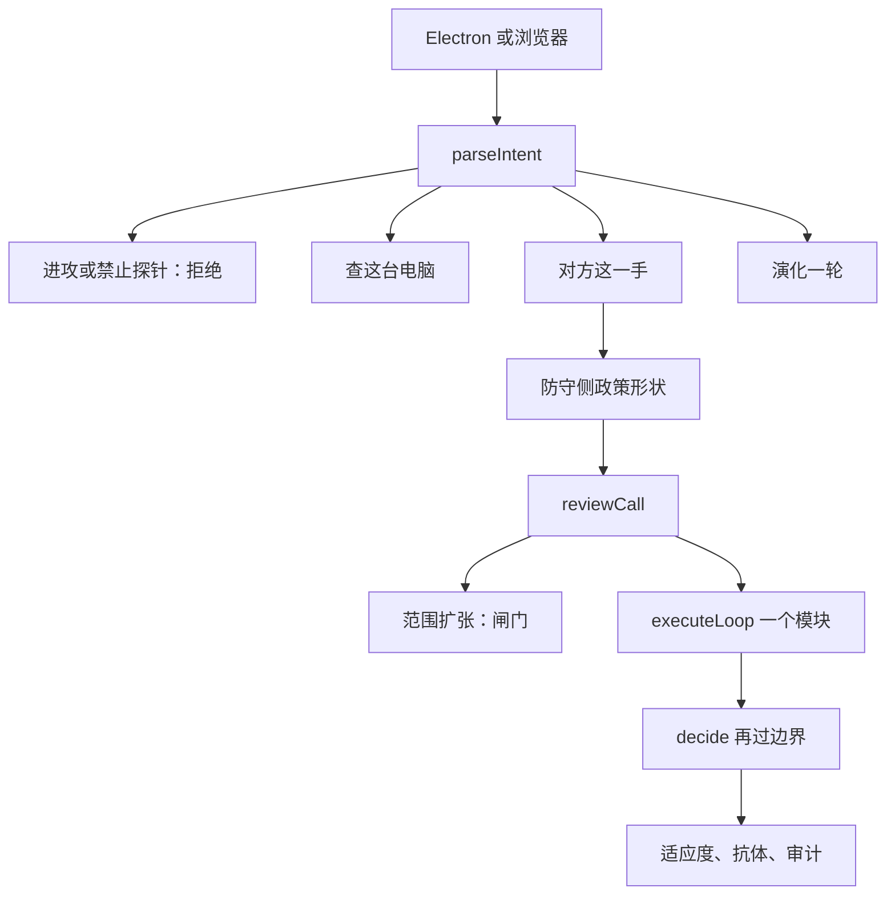
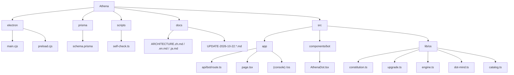
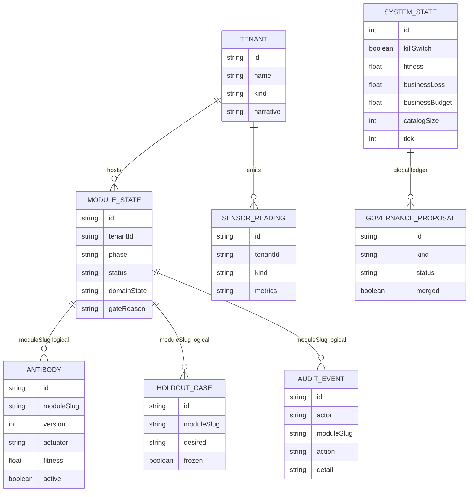

# Athena 2026-10-22 变更记录

本文记录截至 2026-10-22 已经写进仓库、并且能在本机对话里跑起来的变更。Athena 仍是住在机主电脑上的个人防守 Bot。十五个已签名动作没有变长。本文不提供扫描、利用、载荷或攻击步骤。

## 理念

攻击方把模型放进工具循环以后，便宜的赢法是让防守代理自己把权限变大。Athena 把循环留下，把「自己加工具」删掉。

一轮仍然是：观察己方遥测，推断防守侧的政策形状，提议一个已签名动作，在冻结留出集上评估，晋升或交给人，失败就回滚。适应度 = 攻击方成本 − 业务损失 − 4 × 物理风险。告警条数不能晋升。杀开关在被评分的循环外面。

对手分析只读防守侧形状：节奏、工具调用、范围扩张、泄漏字段标记、重复序列、停顿、委托方健康、设定值漂移。不读对方载荷，不进入对方网络，不识别对方底座模型的厂商。

2026-10-22 把六层防守写成宪法里的法律。它们约束决策，不增加第十六个动作。

| 层 | 在系统里实际做的事 |
| --- | --- |
| 智能体边界控制 | 每个动作先对照十五个已签名动作和禁止项。越界就重置，不执行。 |
| 可验证信任根 | 对动作清单、禁止项、六层名称和杀开关做软件哈希。这台机器不宣称硬件安全包厢已运行。 |
| 代码自愈闸门 | 补丁只留短提案。说明里出现禁止项就不接受。自检通过前不合并，合并也不增加动作。 |
| 对手形状识别 | 把对方这一手映射成政策形状。不向对方发探针。 |
| 移动目标 | 按形状轮换已签名动作，例如隔离或轮换非人身份。不改真实地址、端口或路由。 |
| 合成自我博弈 | 红方只改合成实体计数。蓝方只选十五个动作。对话里的实战一轮会跑对应模块；业务预算用满时记下这一手，适应度不再上升。 |

## 变更方案

报告里能落进 Athena 的，是仍守住封闭清单的控制。变更按三层接上，但没有把清单改成攻击工具。

1. **信任根与边界。** `decide` 返回前再过一次 `reviewCall`。禁止项增加：定向模糊测试、提取崩溃用例、主动模型探针、识别底座模型、真实改址、路由变异、保存攻击工具链、搜索提权路径。
2. **对话里的出招。** 去掉单独的「次世代升级」按钮。人在输入框写下对方这一手，系统选定一个已签名动作，并尝试走该模块的观察—评估—晋升。范围扩张只停在闸门。
3. **桌面壳。** 打开窗口时，对本机页面的探测从 1.5 秒放宽到 8 秒，并重试。页面服务已在跑时不再另起一个。探测失败也不会挡住窗口。

没有接上的部分：模糊测试、对外探针、多跳提权搜索、真实修改网络地址、硬件包厢、未测量的百分比。

## 功能

在 http://127.0.0.1:3030 的对话框里：

- 「对方在试探」或「工具调用突然升高」：形状是工具突发，选定隔离受损域。
- 「触达节奏过稳」：选定轮换非人身份。
- 「委托方健康度下降」：选定拉开已批准的委托断路器。
- 「范围扩张」：边界重置，停在闸门，不执行。
- 业务损失已经等于预算时，选定的动作会写入模块状态，适应度保持不变。这是预算闸门，不是动作没有发生。
- 查电脑、共享画面、摄像头、演化、杀开关、进攻拒绝，仍按原边界工作。

## 架构

宪法在 `src/lib/os/constitution.ts`。出招映射在 `src/lib/os/upgrade.ts`。对话入口在 `src/app/api/bot/route.ts`。界面在 `src/components/bot/AthenaDot.tsx`。

## 构成：目录树

## ER 图

实线是 Prisma 外键。虚线是用 `moduleSlug` 串起来的逻辑关系，数据库没有单独的外键约束。`SystemState` 和 `GovernanceProposal` 是全局账，不挂在某个租户上。

`catalogSize` 保持 15。治理提案可以待决，批准也不把清单变长。

## 代码变更

| 文件 | 变更 |
| --- | --- |
| `src/lib/os/constitution.ts` | 增加六层法律、`reviewCall`、补丁闸门、形状指纹、移动目标映射、合成实体步进和组相对奖励。禁止项写上报告里的进攻能力名称。 |
| `src/lib/os/upgrade.ts` | 新文件。软件哈希、合成博弈、对方这一手到模块的映射。 |
| `src/lib/os/engine.ts` | `decide` 在返回前再过边界。越界动作改成空，并写上闸门理由。 |
| `src/lib/os/dot-mind.ts` | 对方出招变成 `duel`。单独的升级口号只提示人写下这一手。 |
| `src/app/api/bot/route.ts` | 按形状跑对应模块。范围扩张不执行。对话返回不再等待本机权重量扫描。 |
| `src/components/bot/AthenaDot.tsx` | 去掉「次世代升级」按钮。回复是普通对话气泡。请求超过二十秒会结束等待。 |
| `electron/main.cjs` | 页面探测更耐等。服务已在时不重复拉起。 |
| `scripts/self-check.ts` | 核对六层、软件信任根、禁止项、出招意图，以及清单仍是十五。 |

二十二个模块和十五个动作的名单没有增删。合成租户仍只是演示数据。
