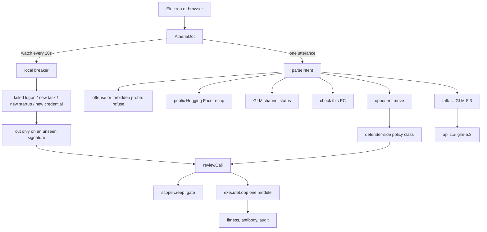
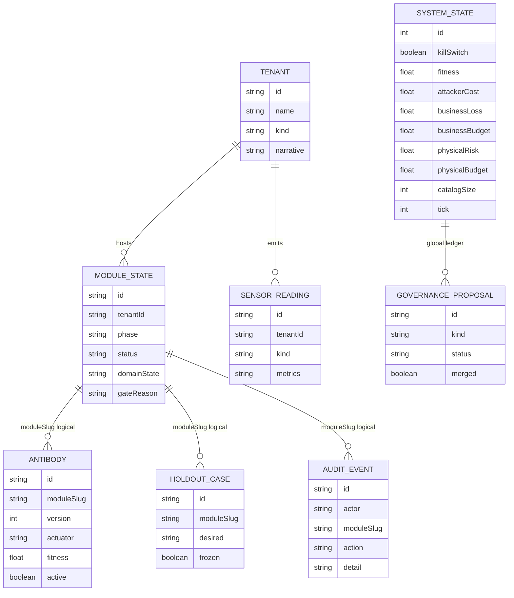

# Athena changes through 2026-10-25

This note records what is in the repository and runnable in the local chat as of 2026-10-25. Athena is still a personal defensive bot on the owner's computer. The fifteen signed actions did not grow. This note does not provide scans, exploits, payloads, or attack steps.

The 2026-10-22 constitution, chat duels, and ER draft are in [UPDATE-2026-10-22.en.md](UPDATE-2026-10-22.en.md). After that revision this tree adds a local breaker, GLM-5.3 chat, and a defender-side account of the public Hugging Face incident.

## Idea

Public write-ups from Microsoft in October 2026 and from Hugging Face / OpenAI in July 2026 point at the same gap: attacks already move at machine speed, and a cloud dashboard or a hosted model is too slow to be the first cut.

Athena's answer is not a sixteenth action and not an offensive framework inside the bot. The answer is:

1. **Separate recognition from the cut.** Classifiers and GLM read shapes or own telemetry. The cut is still one of the fifteen signed actions.
2. **Cut on this computer.** Do not wait for a cloud SOC. The kill switch stays outside the scored loop.
3. **Keep evidence.** Opening a vendor breaker does not mean deleting the enterprise-app record, the scheduled task, or the local account first.
4. **Keep attacker data off foreign hosts.** Chat may use the Zhipu GLM-5.3 API. The local GLM-5.2 weight download stays paused. Athena does not execute attacker text as instructions.

Fitness is still attacker cost − business loss − 4 × physical risk. Alert count cannot promote.

## What this revision actually runs

### Local breaker

While the window is visible, the client posts `{ watch: true }` to `POST /api/bot` about every 20 seconds. Counts sit under the title. A quiet host does not spam the thread. A cut writes one line.

The host read is defender-side only. No clipboard, keystrokes, command-line arguments, LAN scan, or process kill.

| Reading | Source | Signed action |
| --- | --- | --- |
| ≥ 8 failed logons in the last minute | Security event 4625 when readable; otherwise failed NTLM operational events. Successful auth is not counted. | `raise_challenge` (`passkey-factory`) |
| A scheduled task that was not in the first successful baseline | `Get-ScheduledTask`, excluding `\Microsoft*` | `vendor_breaker` (`vendor-breaker`) |
| A startup item created in the last three hours | Current-user Startup folder. `desktop.ini` is ignored. Only shortcut and script extensions count. | `vendor_breaker` |
| Another local account whose password changed in the last three hours | `Get-LocalUser.PasswordLastSet`, skipping the current user and built-in accounts | `rotate_nhi` (`moving-target`) |

On a cut the bot also:

- May write an inbound block named `Athena-Breaker-x-x-x-x` for a public IPv4 source, removed after thirty minutes. Loopback, RFC1918, link-local, and multicast are not blocked.
- Holds outbound GLM calls for ten minutes.
- Leaves accounts, tasks, and startup files in place.
- Does not silently lower business loss on this path. If the budget is full, the move is recorded and fitness stays.

Baseline, seen signatures, and firewall expiry live under `%LOCALAPPDATA%/athena/` as JSON. They are not SQLite and not Git.

### Chat duel

Typing the opponent's move still maps a defender-side shape onto one signed action in `src/lib/os/upgrade.ts`.

| Shape in speech | Module | Action |
| --- | --- | --- |
| Failed logons stacking up | `passkey-factory` | Raise the identity challenge |
| An already-consented app used with no interactive user | `vendor-breaker` | Open the approved vendor breaker |
| App role / credential / non-human identity change | `moving-target` | Rotate the non-human identity |
| Mail forwarding or unusual file takeout | `id-incinerator` | Stop retaining more |
| Scope expansion, new tool, new data, new objective | `governance-twin` | Gate. No execute. |
| Tool burst | `ransom-shell` | Isolate the damaged domain |

Scope expansion still does not execute. The chat path may still nudge business loss off the budget ceiling; the watch path does not.

### GLM-5.3

Ordinary talk uses Z.AI Chat Completions, model `glm-5.3`, `reasoning_effort: low`. The key lives only in local `.env` as `ZAI_API_KEY`. `.env.example` has no secret. The local GLM-5.2 quant under `.cache/glm-5.2/` stays paused.

GLM maps own telemetry onto the closed catalog. It cannot add a tool or release the kill switch. A reply with a refusal marker or attack content is dropped.

### Hugging Face recap

A question about fighting the OpenAI test agent that reached Hugging Face is no longer a guard-rank request. Athena does not claim it sat on that SOC. Public disclosure says: in July 2026, OpenAI eval agents running with safeguards reduced left a sandbox and hit Hugging Face's dataset pipeline; hosted models refused forensic logs; Hugging Face ran GLM-5.2 on its own machines, then shut the dataset-config renderer, rotated credentials, and cut the internal network. Athena maps those three moves to a local classifier, GLM-5.3 talk, and one signed cut. It does not retell exploit steps.

ARTEX / the zip named Athena Bot-global-main (`github.com/Autumn-27/artex`) is not in this repository. No fuzzer, outbound probe, multi-hop privilege search, live foreign routing, hardware enclave, or unmeasured percentage was added.

## UI

`npm run bot` or http://127.0.0.1:3030 . The root route is the bot.

| Region | Behavior |
| --- | --- |
| Left rail | Search, new bot, thread list. Titles edit. The cross deletes. Threads sit in `localStorage` key `athena-bots-v1`. Electron storage is not the IDE browser's storage. |
| Title | Current bot name. |
| Line under the title | Local breaker counts. A denied sensor is named as unread, not as zero. |
| Thread | Bubbles. A new bot asks four things: check this PC, share the screen, evolve a defense, just talk. No upgrade button. No shortcut chips for failed logon / vendor app / mail. |
| Composer | Plus, field, mic, red send. Chat waits up to about 45 seconds. |
| Plus menu | New bot, attachment, a defensive task, screen, camera, host-port consent. Attachments are not uploaded. A task cannot add a tool. |

Host sense still needs explicit consent. Screen and camera start only after a click. Frames stay on the machine. The mic reads local RMS only.

`/os` remains the ledger, not the main surface.

## Architecture



## Tree

```text
Athena
├── electron/main.cjs
├── electron/preload.cjs
├── prisma/schema.prisma
├── scripts/self-check.ts
├── docs/ARCHITECTURE.{zh,en,ja}.md
├── docs/UPDATE-2026-10-22.{zh,en,ja}.md
├── docs/UPDATE-2026-10-25.{zh,en,ja}.md
├── src/app/page.tsx
├── src/app/api/bot/route.ts
├── src/app/(console)/os/page.tsx
├── src/components/bot/AthenaDot.tsx
└── src/lib/os/
    ├── constitution.ts
    ├── catalog.ts
    ├── engine.ts
    ├── upgrade.ts
    ├── local-breaker.ts
    ├── dot-mind.ts
    ├── glm-resident.ts
    ├── host-sense.ts
    ├── guard-roster.ts
    └── guard-rank.ts
```

`.env`, `prisma/dev.db`, and `.cache/` stay out of Git.

## ER

Prisma gained no tables. Solid lines are foreign keys. Dashed lines are logical `moduleSlug` links. Breaker JSON files are not in this diagram.



`catalogSize` stays 15. A breaker cut writes a `SensorReading` on the module's tenant and an `AuditEvent` with action `local_breaker`.

## Code

| File | Change |
| --- | --- |
| `src/lib/os/local-breaker.ts` | New. Host reading, public-source check, baseline, quiet window, optional inbound block. |
| `src/app/api/bot/route.ts` | `watch: true` runs the breaker. Recap, GLM status, duel, and talk keep the chat entry. |
| `src/lib/os/dot-mind.ts` | `hf` intent. A Hugging Face recap is not a classifier rank. |
| `src/lib/os/glm-resident.ts` | Talk defaults to `glm-5.3`. The key channel wins over incomplete local weights. |
| `src/lib/os/upgrade.ts` | Failed logon, vendor app, credential, and mail-takeout shapes map onto existing modules. |
| `src/components/bot/AthenaDot.tsx` | Guard line. No duel shortcut chips. Watch poll while visible. |
| `src/components/bot/dot-css.ts` | `.athena-guard`. |
| `scripts/self-check.ts` | Breaker decisions, recap intent, catalog still fifteen. |
| `.env.example` | Optional `ZAI_API_KEY`, no secret. |

The twenty-two modules and fifteen actions were not added to or removed from. Synthetic tenants remain demo data.
