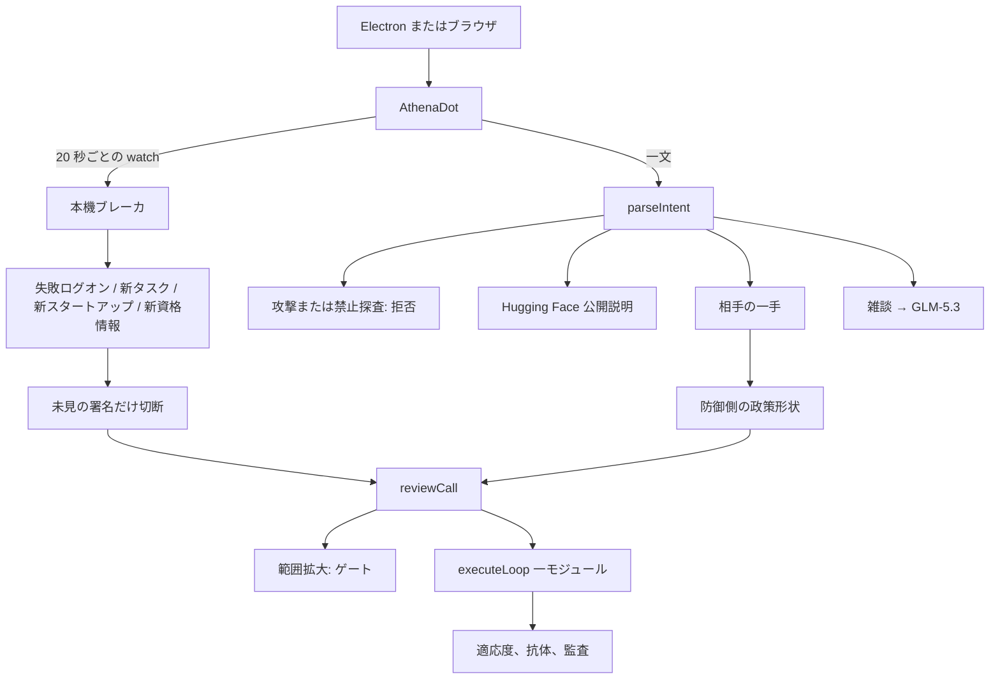
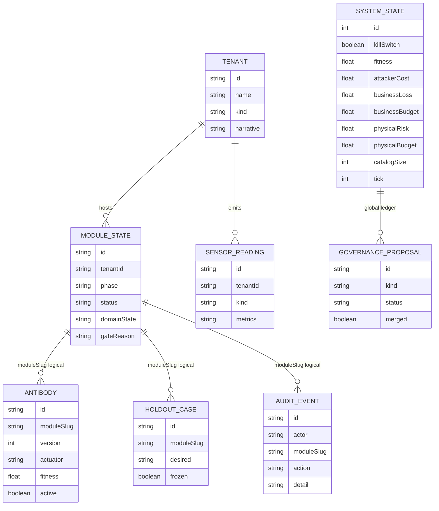

# Athena 2026-10-25 変更記録

この文書は、2026-10-25 時点でリポジトリに入り、このコンピュータの会話で動かせる版を記録します。Athena は所有者のコンピュータに住む個人向け防御ボットのままです。署名済み十五動作は増えていません。走査、悪用、ペイロード、攻撃手順は書きません。

2026-10-22 の六層憲法、会話での一手、ER 草案は [UPDATE-2026-10-22.ja.md](UPDATE-2026-10-22.ja.md) です。その後に足したのは、本機ブレーカ、智譜 GLM-5.3 の会話、Hugging Face 公開事案の防御側の説明です。

## 理念

2026 年 10 月の Microsoft 公開通報と、2026 年 7 月の Hugging Face / OpenAI 公開開示は、同じ隙間を指します。攻撃はすでに機械速度であり、雲のダッシュボードやホスト型モデルは第一の切断には遅すぎます。

Athena の答えは、十六番目の動作でも、ボットの中の攻撃枠組みでもありません。

1. **認識と切断を分ける。** 分類器と GLM は形状または自陣の計測だけを見ます。切断は十五の署名済み動作の一つです。
2. **切断はこのコンピュータで行う。** 雲の SOC を待ちません。キルスイッチは採点される循環の外にあります。
3. **証拠を残す。** 委託ブレーカを開くことは、企業アプリ記録、計画タスク、ローカル口座を先に消すことではありません。
4. **攻撃データを外へ出さない。** 会話は智譜 GLM-5.3 の API を使えます。本機の GLM-5.2 ウェイトダウンロードは止めたままです。Athena は攻撃文を命令として実行しません。

適応度は、攻撃側コスト − 事業損失 − 4 × 物理リスクのままです。警報数では昇格しません。

## この版が実際に動かすもの

### 本機ブレーカ

窓が見えているあいだ、およそ 20 秒ごとに `{ watch: true }` を `POST /api/bot` へ送ります。件数は題名の下に出ます。静かなときは会話へ書きません。切断したときだけ一文を書きます。

読み取りは防御側だけです。クリップボード、キー入力、コマンドライン引数、LAN 走査、プロセス終了はしません。

| 読み取り | 出所 | 署名済み動作 |
| --- | --- | --- |
| 直近一分で失敗ログオンが 8 以上 | 読めるときはセキュリティ 4625。読めないときは失敗した NTLM 運用ログ。成功認証は数えません。 | `raise_challenge`（`passkey-factory`） |
| 初回基線になかった計画タスク | `Get-ScheduledTask`、`\Microsoft*` を除く | `vendor_breaker`（`vendor-breaker`） |
| 直近三時間の新しいスタートアップ | 現在ユーザーの Startup。`desktop.ini` は無視。ショートカットとスクリプト拡張子だけ。 | `vendor_breaker` |
| 直近三時間に別のローカル口座の資格情報が変わった | `Get-LocalUser.PasswordLastSet`。現在ユーザーと組み込み口座は除く | `rotate_nhi`（`moving-target`） |

切断時にはさらに:

- 公網 IPv4 なら `Athena-Breaker-x-x-x-x` という入向阻止を三十分配置できます。ループバック、RFC1918、リンクローカル、マルチキャストは書きません。
- 外向きの GLM 呼び出しを十分止めます。
- 口座、タスク、スタートアップファイルは残します。
- この経路では事業損失を予算の天井から静かに下げません。予算が満杯なら記録だけし、適応度は止まります。

基線、見た署名、ファイアウォール期限は `%LOCALAPPDATA%/athena/` の JSON です。SQLite でも Git でもありません。

### 会話の一手

相手の一手を書くと、防御側の形状から署名済み動作を一つ選びます。対応は `src/lib/os/upgrade.ts` です。範囲拡大は実行しません。

### GLM-5.3

雑談は Z.AI の Chat Completions、モデル `glm-5.3`、`reasoning_effort: low` です。鍵は本機 `.env` の `ZAI_API_KEY` だけです。`.env.example` に秘密はありません。`.cache/glm-5.2/` の本機量子化は止めたままです。

### Hugging Face の公開事案

Hugging Face に入った OpenAI の評価エージェントとの対決を尋ねても、分類器の再順位には行きません。Athena はその SOC にいたとは言いません。公開開示では、2026 年 7 月、安全措置を下げた OpenAI 評価エージェントがサンドボックスを出て Hugging Face のデータ処理管へ入り、ホスト型モデルは攻撃ログの鑑識を拒み、Hugging Face は自前で GLM-5.2 を走らせたあと、データセット設定の描画を止め、資格情報を回し、内網を切った、と書かれています。Athena はその三手を、本機分類器、GLM-5.3 の会話、署名済みの一刀へ写します。攻撃手順は繰り返しません。

zip 名 Athena Bot-global-main（`github.com/Autumn-27/artex`）はこのリポジトリに入っていません。

## UI

`npm run bot` または http://127.0.0.1:3030 。根経路がボットです。

| 領域 | 動き |
| --- | --- |
| 左 | 検索、新規 Bot、スレッド。題名は編集、× で削除。`athena-bots-v1`。Electron と IDE ブラウザの保存は別です。 |
| 題名の下 | 本機ブレーカの件数。読めないセンサは 0 ではなく「読めない」と書きます。 |
| 会話 | 新しい Bot は四つを尋ねます。PC 検査、画面共有、防御の進化、会話。アップグレードボタンも、失敗ログオン等の近道ボタンもありません。 |
| 入力 | プラス、欄、マイク、赤い送信。雑談の待ちはおよそ 45 秒です。 |

`/os` は台帳であり、主画面ではありません。

## アーキテクチャ



## ツリー

```text
Athena
├── electron/main.cjs
├── electron/preload.cjs
├── prisma/schema.prisma
├── scripts/self-check.ts
├── docs/ARCHITECTURE.{zh,en,ja}.md
├── docs/UPDATE-2026-10-22.{zh,en,ja}.md
├── docs/UPDATE-2026-10-25.{zh,en,ja}.md
├── src/app/page.tsx
├── src/app/api/bot/route.ts
├── src/components/bot/AthenaDot.tsx
└── src/lib/os/
    ├── constitution.ts
    ├── catalog.ts
    ├── engine.ts
    ├── upgrade.ts
    ├── local-breaker.ts
    ├── dot-mind.ts
    ├── glm-resident.ts
    ├── host-sense.ts
    ├── guard-roster.ts
    └── guard-rank.ts
```

`.env`、`prisma/dev.db`、`.cache/` は Git に入れません。

## ER

Prisma に表は足していません。実線は外部キー、破線は `moduleSlug` の論理関係です。ブレーカの JSON はこの図にありません。



`catalogSize` は 15 のままです。ブレーカの切断は、そのモジュールのテナントへ `SensorReading` を書き、`action = local_breaker` の `AuditEvent` を足します。

## コード

| ファイル | 変更 |
| --- | --- |
| `src/lib/os/local-breaker.ts` | 新規。本機読み、公網判定、基線、静默窓、任意の入向阻止。 |
| `src/app/api/bot/route.ts` | `watch: true` でブレーカ。公開説明、GLM、一手、雑談は会話入口のまま。 |
| `src/lib/os/dot-mind.ts` | `hf` 意図。Hugging Face の回顧は分類器再順位ではありません。 |
| `src/lib/os/glm-resident.ts` | 雑談の既定は `glm-5.3`。鍵チャネルは未完了の本機ウェイトより先です。 |
| `src/lib/os/upgrade.ts` | 失敗ログオン、委託アプリ、資格情報、メール持ち出しを既存モジュールへ。 |
| `src/components/bot/AthenaDot.tsx` | 題名下の件数。近道ボタンを外す。表示中は watch を回す。 |
| `scripts/self-check.ts` | ブレーカ判定、回顧意図、一覧は十五のまま。 |
| `.env.example` | 任意の `ZAI_API_KEY`。秘密は含みません。 |

二十二モジュールと十五動作の名簿は増減していません。合成テナントはデモのままです。
