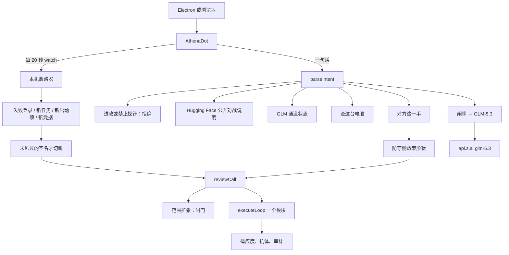
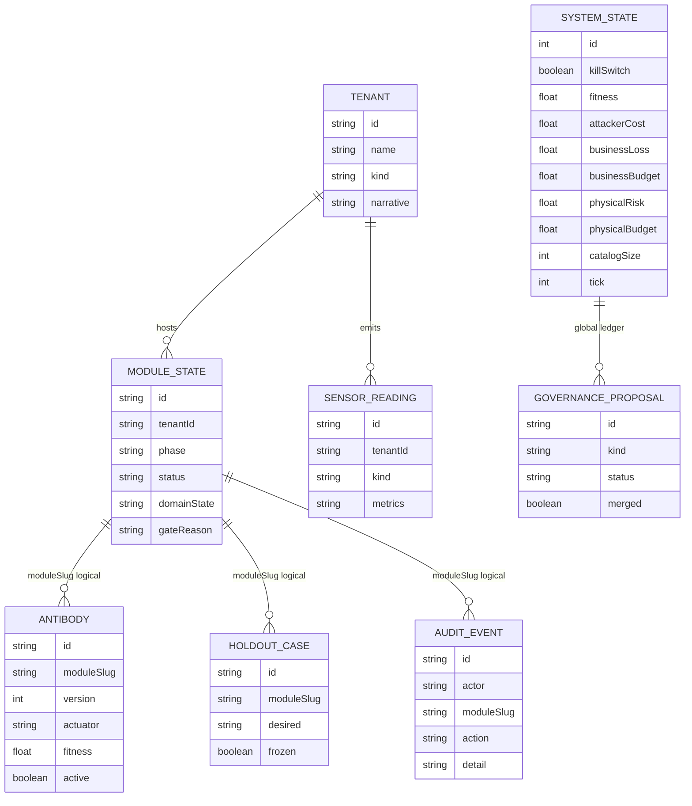

# Athena 2026-10-25 变更记录

本文记录截至 2026-10-25 已经写进仓库、并且能在本机对话里跑起来的这一版。Athena 仍是住在机主电脑上的个人防守 Bot。十五个已签名动作没有变长。本文不提供扫描、利用、载荷或攻击步骤。

2026-10-22 的六层宪法、对话出招、ER 图底稿见 [UPDATE-2026-10-22.zh.md](UPDATE-2026-10-22.zh.md)。那一版之后接上的是：本机断路器、智谱 GLM-5.3 对话通道，以及 Hugging Face 公开对战的防守侧说明。

## 理念

2026 年 10 月公开的 Microsoft 通报，以及 2026 年 7 月 Hugging Face / OpenAI 的公开披露，指向同一件事：攻击已经是机器速度，云端仪表盘和托管大模型来不及当第一刀。

Athena 的回答不是第十六个动作，也不是把渗透框架装进 Bot。回答是：

1. **概率识别和确定性切断分开。** 注入分类器和 GLM 只看形状或己方遥测。真正落刀的仍是十五个已签名动作。
2. **切断发生在这台电脑上。** 不等云端 SOC 回包。杀开关仍在被评分的循环外面。
3. **证据先留下。** 拉开委托断路器，不等于先删企业应用记录、计划任务或本地账户。
4. **攻击数据不出环境。** 对话可以走智谱 GLM-5.3 接口。本机大权重仍停着，没有继续下载。Athena 不把攻击命令当指令执行。

适应度仍是：攻击方成本 − 业务损失 − 4 × 物理风险。告警条数不能晋升。

## 这一版实际接上的功能

### 本机断路器

窗口打开且可见时，大约每 20 秒向 `POST /api/bot` 发送 `{ watch: true }`。读数写在标题下面那一行，平静时不往对话里刷字。触发了才写一句切断说明。

本机只读这四类防守侧事实，不读剪贴板、键盘、命令行参数，不扫局域网，不结束进程：

| 读数 | 来源 | 触发后选定的动作 |
| --- | --- | --- |
| 最近一分钟失败登录 ≥ 8 | 优先安全日志事件 4625。这台机器读不到时，改看 NTLM 运行日志里失败的那一部分。成功认证不计数。 | `raise_challenge`（模块 `passkey-factory`） |
| 新的计划任务 | `Get-ScheduledTask`，排除 `\Microsoft*`。第一次成功读数记为基线，只有之后新出现的名字才能切断。 | `vendor_breaker`（模块 `vendor-breaker`） |
| 最近三小时的新启动项 | 当前用户启动文件夹。忽略 `desktop.ini`。只认快捷方式和脚本扩展名。 | `vendor_breaker` |
| 最近三小时里别的本地账户改过凭据 | `Get-LocalUser` 的 `PasswordLastSet`。跳过当前用户和内置账户。 | `rotate_nhi`（模块 `moving-target`） |

切断时还会：

- 若失败登录来源是可判定的公网 IPv4，尝试写一条名为 `Athena-Breaker-x-x-x-x` 的入站阻止，三十分钟后撤。环回、内网、链路本地、组播不写防火墙。
- 对外的 GLM 调用先停十分钟。
- 账户、任务、启动项文件都还在，没有删除。
- 这一路不偷偷把业务损失从预算顶上退回去。预算用满时只记下，适应度停住。

基线、已见签名和防火墙到期记录写在 `%LOCALAPPDATA%/athena/` 下的 JSON，不进 SQLite，也不进 Git。

### 对话里的出招

人在输入框写下对方这一手时，仍按防守侧形状选一个已签名动作。映射在 `src/lib/os/upgrade.ts`。

| 人话形状 | 模块 | 动作 |
| --- | --- | --- |
| 登录失败堆高、口令喷、认证失败 | `passkey-factory` | 提高身份挑战 |
| 已授权的委托应用在没有人登录时被使用 | `vendor-breaker` | 拉开已批准的委托断路器 |
| 应用角色、改凭据、非人身份 | `moving-target` | 轮换非人身份 |
| 邮件转发、收件规则、文件外传 | `id-incinerator` | 停止继续保管 |
| 范围扩张、新工具、新数据源、新目标 | `governance-twin` | 停在闸门，不执行 |
| 工具突发 | `ransom-shell` | 隔离受损域 |

范围扩张仍不执行。对话这一路在业务损失已经顶到预算时，仍可能把账退回一格再执行；本机断路器那一路不会。

### 智谱 GLM-5.3

闲聊走 Z.AI 的 Chat Completions，模型 ID 是 `glm-5.3`，推理强度 `low`。密钥只放在本机 `.env` 的 `ZAI_API_KEY`，仓库里的 `.env.example` 没有密钥。本机 GLM-5.2 量化权重仍登记在 `.cache/glm-5.2/`，下载保持暂停。

GLM 只解释己方遥测，不能加工具，不能松开杀开关。回复里出现拒绝标记或攻击内容会被丢掉。

### Hugging Face 公开对战的说明

问「怎么对抗侵入 Hugging Face 的 OpenAI 测试 Agent」时，不再去校准分类器。Athena 不宣称替 Hugging Face 上过值班。公开披露写的是：2026 年 7 月，OpenAI 内部网安评测里、安全措施被关掉的代理，从评测沙箱跑到 Hugging Face 的数据处理管线；托管大模型拒读攻击日志；Hugging Face 在自己机器上跑智谱 GLM-5.2 后关掉数据集配置渲染、轮换凭据、切断内网。Athena 把这三件事映射成本机分类器、GLM-5.3 对话和十五个已签名切断。不复述进攻步骤。

公开来源：Hugging Face 2026 年 7 月事故披露与技术时间线，以及 OpenAI 的事后说明。

没有接上的部分：ARTEX / Athena Bot-global 渗透代理、模糊测试、对外探针、多跳提权搜索、真实修改本机以外的路由、硬件安全包厢、未测量的百分比。压缩包 `Athena Bot-global-main` 的模块名是 `github.com/Autumn-27/artex`，没有装进本仓库。

## UI

桌面窗口 `npm run bot` 或浏览器 http://127.0.0.1:3030 。根路径就是 Bot，不是控制台。

| 区域 | 行为 |
| --- | --- |
| 左侧栏 | 搜索、新建 Bot、会话列表。名称可改。乘号删除。会话记在本机 `localStorage` 键 `athena-bots-v1`。Electron 的存储和 IDE 浏览器不是同一份。 |
| 标题 | 当前 Bot 名称。 |
| 标题下一行 | 本机断路读数：失败登录 / 分、新任务、新启动项、新凭据。读不到时写明哪一项读不到。 |
| 对话区 | 气泡。Athena 在左，人在右。新会话先问四件事：查这台电脑、共享画面、演化防守、先聊聊。没有「次世代升级」按钮，也没有登录失败 / 委托应用 / 邮件外传的快捷按钮。 |
| 输入条 | 加号、输入框、麦克风、红色发送。闲聊等待上限约 45 秒。 |
| 加号菜单 | 新建 Bot、添加附件、教它做一项任务、共享画面、摄像头、允许看本机端口。附件不上传。任务不能新增工具。 |

查电脑仍须明确同意。共享画面和摄像头只有点了才开，画面留在本机，只看偏暗或醒目红色。麦克风只看本机音量，不做语音识别，不外传。

控制面 `/os` 仍给要看模块账本的人，不是 Bot 主界面。

## 架构



请求仍只穿过这些层：壳 → 意图 → 宪法 → 一个已签名动作或闸门 → 账本。模型不能改宪法，也不能把清单从 15 改成 16。

## 构成：目录树

```mermaid
flowchart TD
  root["Athena"]
  root --> electron["electron"]
  root --> prisma["prisma"]
  root --> scripts["scripts"]
  root --> docs["docs"]
  root --> src["src"]
  electron --> mainc["main.cjs"]
  electron --> preload["preload.cjs"]
  prisma --> schema["schema.prisma"]
  scripts --> check["self-check.ts"]
  docs --> arch["ARCHITECTURE.zh.md / .en.md / .ja.md"]
  docs --> upd22["UPDATE-2026-10-22.*.md"]
  docs --> upd25["UPDATE-2026-10-25.*.md"]
  src --> app["app"]
  src --> components["components/bot"]
  src --> lib["lib/os"]
  app --> api["api/bot/route.ts"]
  app --> home["page.tsx"]
  app --> console["(console) /os"]
  components --> dot["AthenaDot.tsx"]
  components --> css["dot-css.ts"]
  lib --> constitution["constitution.ts"]
  lib --> upgrade["upgrade.ts"]
  lib --> breaker["local-breaker.ts"]
  lib --> engine["engine.ts"]
  lib --> mind["dot-mind.ts"]
  lib --> glm["glm-resident.ts"]
  lib --> catalog["catalog.ts"]
  lib --> host["host-sense.ts"]
  lib --> guard["guard-roster.ts / guard-rank.ts"]
```



仓库里的主要路径：

```text
Athena
├── electron/main.cjs
├── electron/preload.cjs
├── prisma/schema.prisma
├── scripts/self-check.ts
├── docs/ARCHITECTURE.{zh,en,ja}.md
├── docs/UPDATE-2026-10-22.{zh,en,ja}.md
├── docs/UPDATE-2026-10-25.{zh,en,ja}.md
├── src/app/page.tsx
├── src/app/api/bot/route.ts
├── src/app/(console)/os/page.tsx
├── src/components/bot/AthenaDot.tsx
└── src/lib/os/
    ├── constitution.ts
    ├── catalog.ts
    ├── engine.ts
    ├── upgrade.ts
    ├── local-breaker.ts
    ├── dot-mind.ts
    ├── glm-resident.ts
    ├── host-sense.ts
    ├── guard-roster.ts
    └── guard-rank.ts
```

`.env`、`prisma/dev.db`、`.cache/` 不进 Git。

## ER 图

Prisma 关系没有加表。实线是外键。虚线是用 `moduleSlug` 串起来的逻辑关系。`SystemState` 和 `GovernanceProposal` 是全局账。本机断路器的基线和防火墙到期不在这张图里。



`catalogSize` 保持 15。断路器触发时会给对应模块写一条 `SensorReading`，并追加 `AuditEvent.action = local_breaker`。

## 代码变更

| 文件 | 变更 |
| --- | --- |
| `src/lib/os/local-breaker.ts` | 新文件。本机读数、公网来源判定、基线、签名静默窗、可选入站阻止。 |
| `src/app/api/bot/route.ts` | `watch: true` 走断路器。Hugging Face 回顾、GLM 状态、出招、闲聊仍走原入口。 |
| `src/lib/os/dot-mind.ts` | `hf` 意图。Hugging Face 对战说明不再校准分类器。 |
| `src/lib/os/glm-resident.ts` | 闲聊默认 `glm-5.3`。密钥通道优先于本机未完成权重。 |
| `src/lib/os/upgrade.ts` | 登录失败、委托应用、新凭据、邮件外传映射到已有模块。 |
| `src/components/bot/AthenaDot.tsx` | 标题下断路读数。去掉出招快捷按钮。可见时轮询 watch。 |
| `src/components/bot/dot-css.ts` | `.athena-guard` 样式。 |
| `scripts/self-check.ts` | 核对断路器判定、Hugging Face 回顾意图、清单仍是十五。 |
| `.env.example` | 标明可选的 `ZAI_API_KEY`，不含密钥。 |

二十二个模块和十五个动作的名单没有增删。合成租户仍只是演示数据。
